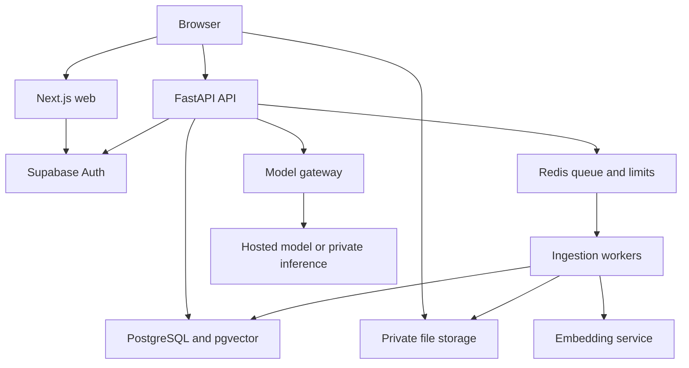

# System architecture

[Documentation index](README.md) | Version 1.0 | 31 October 2026

Browser uploads directly using a short-lived authorized upload mechanism; it does not receive a privileged storage key. Finalization verifies the actual stored object. Long-running ingestion never runs inside a web request or a serverless page handler.

### Responsibilities

| Component | Owns | Must avoid |
|---|---|---|
| Web | UI, session UX, source navigation | Privileged keys or authorization based only on hidden buttons |
| API | JWT verification, ownership, orchestration, streaming, quotas | Parsing entire PDFs during upload request |
| Worker | Safe extraction, chunks, embeddings, retry | Trusting user-submitted owner IDs |
| Database | Durable metadata, RLS, chunks, messages, outbox | Global unfiltered vector retrieval |
| Queue | Delivery, scheduling and throttling | Being the sole record of a job |
| Model gateway | Timeouts, provider adapter, usage and concurrency | Exposing model servers publicly without authentication |

### Key decisions and tradeoffs

- Use PostgreSQL vectors first to keep ownership and metadata close to retrieval. Consider a separate vector engine only after measured database limits.
- Keep the browser out of privileged database paths. Use verified user-scoped database calls so RLS applies.
- Use a constrained system database role for background work. A Supabase service-role key bypasses RLS; it requires explicit ownership predicates and narrow code paths.
- Use shared infrastructure for a private-per-user product. No cross-user sharing in MVP.
- Use application modules instead of independent microservices for every function.

